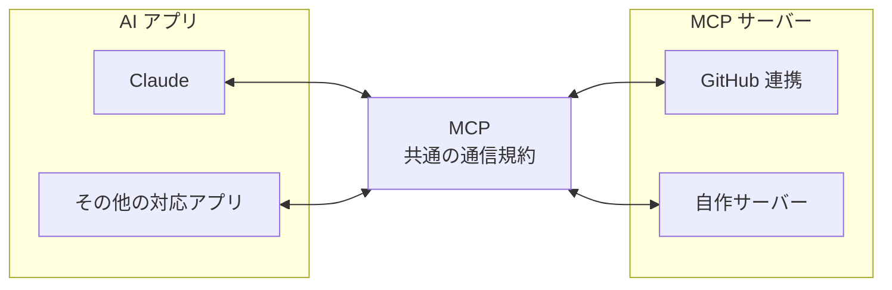
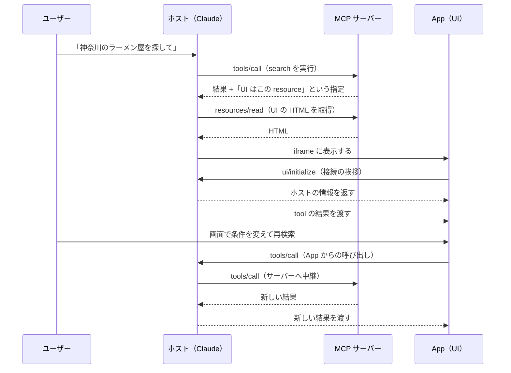
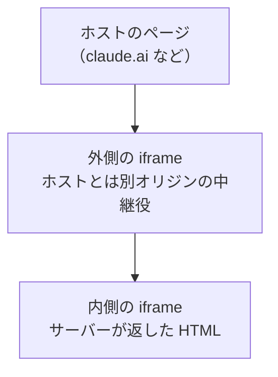

## はじめに

AI との会話の中に、自分で作った地図やフォームを表示できたら便利だと思ったことはないでしょうか。

MCP（Model Context Protocol）を使うと、AI から外部の機能を呼び出せます。ただし、返せるのはテキストや画像といった、表示されるだけのコンテンツです。ユーザーがその場で操作できる画面は返せません。

**MCP Apps は、この「見るだけ」という制約を解消し、インタラクティブな UI を追加する拡張仕様です。**

最近になって家系ラーメンをよく食べるようになり、出先で店を探すことが増えました。ちょうど MCP Apps を触ってみたかったので、題材にして全国の家系ラーメン店を検索できるアプリを作りました。まずは動いている様子を見てください。


会話の中に検索画面が表示され、そのまま手元で操作できています。

:::note warn
**店舗データについて、先にお断りしておきます**

「家系ラーメン」には公式な定義も認定制度もありません（多分。違っていたらすみません）。このアプリの店舗データは OpenStreetMap から取得し、店名やブランド名をもとに機械的に判定しています。

そのため、**家系ラーメン店なのに含まれていない店舗**や、**家系ラーメンではないのに含まれてしまっている店舗**があります。正確な店舗一覧ではなく、MCP Apps を試すために作ったものとして見てください。
:::

:::note info
MCP Apps は開発中の仕様です。この記事は 2026 年 9 月時点の公式ドキュメントに基づいています。
:::

## 1. 何を作ったのか

### 1-1. 3 つの機能を 1 つの画面に入れた

全国の家系ラーメン店を探すアプリです。tool を 3 つ用意しました。どれも同じ UI を開き、表示するモードだけが変わります。

| tool | 役割 |
| --- | --- |
| `search-iekei-ramen` | 都道府県・味の傾向・キーワードで店舗を絞り込む |
| `find-nearby-iekei-ramen` | 現在地や指定した地名から近い上位 5 店舗を表示する |
| `show-iekei-ramen-map` | 全国の店舗を日本地図上にプロットして表示する |

検索フォームは、AI に話しかけても、画面から直接プルダウンを操作しても同じ結果が得られます。


「現在地から探す」では、ブラウザの Geolocation API を使います。位置情報を許可しなかった人のために、地名を入力して座標に変換する道も用意しました（8 章の補助 tool）。


地図モードでは、全店舗を日本地図の上に表示します。地図タイルには OpenStreetMap を使い、Leaflet で描画しています。


### 1-2. 構成は「静的データ + Cloudflare Workers」

| 項目 | 選んだ技術・サービス |
| --- | --- |
| サーバー | Cloudflare Workers |
| UI | React（1 つの HTML にバンドル） |
| 地図 | Leaflet + OpenStreetMap |
| 店舗データ | ビルド時に埋め込む静的 JSON |

動かしている間にデータを書き換えることがないので、データベースも外部ストレージも使っていません。ソースコードは [yamazaki-yuki-23/iekei-ramen-mcp-apps](https://github.com/yamazaki-yuki-23/iekei-ramen-mcp-apps) で公開しています。

### 1-3. 公開しているので、そのまま試せます

MCP サーバーは公開しているので、次の URL をコネクタとして登録すればそのまま使えます。

```
https://iekei-ramen-mcp.yamazaki-dev.workers.dev/mcp
```

Claude なら **設定 → コネクタ → カスタムコネクタを追加**、ChatGPT なら **設定 → コネクタ** から、同じ URL を登録します。あとは「横浜駅の近くの家系ラーメンを教えて」のように話しかければ、記事冒頭の検索画面が開きます。

## 2. MCP Apps とは何か

### 2-1. おさらい：MCP は AI と外部をつなぐ共通規格

MCP は、AI アプリと外部システムをつなぐ通信ルールを定めたオープンな規格です。

MCP が登場する前は、AI アプリごとに接続方法が異なっていました。MCP に対応していれば、1 つのサーバーを複数の AI アプリから共通の方法で利用できます。

:::note info
MCP そのものの仕組みは、以前まとめた記事で詳しく説明しています。
[MCPをゼロから理解する：基本の仕組みから最新の2026-07-28仕様まで](https://qiita.com/tamakiiii/items/fef33203697846f8b5ff)
:::



MCP サーバーが提供する主な機能は次の 2 種類です。

| 種類 | 意味 | 例 |
| --- | --- | --- |
| tool | AI が呼び出せる関数 | 「店舗を検索する」 |
| resource | AI が読み取れるデータ | 設定ファイル、ドキュメント |

### 2-2. MCP だけでは、インタラクティブな UI は返せない

tool が返せるのは、テキスト・画像・音声といった、表示されるだけのコンテンツです。ユーザーがその場で操作できる UI は返せません。

そのため、「検索結果を地図で見たい」「条件をフォームで絞り込みたい」といった要求には応えられません。地図を画像として返すことはできても、ユーザーが地図を拡大したりピンをクリックしたりする操作は行えません。

### 2-3. MCP Apps は、そこにインタラクティブな UI を加えたもの

MCP Apps では、tool の実行結果と連動して **HTML ページ** を表示できます。AI アプリがその HTML を画面内に描画するため、ユーザーは画面上で直接操作を行えます。

ポイントは、画面が会話から切り離されていない点です。ユーザーが画面上で検索条件を変更すると、その結果は AI 側にも共有されます。ユーザーは画面上で操作を続けてもよいですし、会話に戻って「この中で一番近い店は？」と質問することもできます。

### 2-4. 登場人物は 3 つ

MCP Apps には次の 3 つの登場人物がいます。役割を混同すると仕組みが追えなくなるので、ここで分けておきます。

| 呼び方 | 役割 | 具体例 |
| --- | --- | --- |
| ホスト | AI アプリ本体。画面を描画する側 | Claude |
| MCP サーバー | tool と UI を提供する側。開発者が実装するもの | 自作の検索サーバー |
| App | ホストの中で表示される UI そのもの | サーバーが返した HTML |

「App」は、サーバーが返した HTML がホスト内で動作している状態を指します。サーバー本体とは別の存在として捉えてください。

## 3. 全体の流れを図で見る

実装に入る前に、1 回のやり取りでどのような処理が行われるのかを図で確認しておきます。



ここで重要なポイントは次の 2 点です。

1. **App はサーバーと直接通信しない。** 通信は必ずホストを経由します。
2. **tool 呼び出しの入口は 2 つある。** AI が呼ぶ場合と、ユーザーが画面を操作して App が呼ぶ場合です。この違いが後ほど重要になります。

## 4. サーバー側：tool と resource の 2 つを登録する

MCP Apps のサーバー側で行う実装は、要約すると次の 2 つだけです。

1. UI の HTML を返す **resource** を登録する
2. その resource の場所を書いた **tool** を登録する

### 4-1. UI リソースは `ui://` と専用の MIME タイプ

UI リソースには決まりが 2 つあります。どちらも仕様上の必須項目です。

| 項目 | 値 | 理由 |
| --- | --- | --- |
| URI のスキーム | `ui://` で始める | ホストが「これは UI だ」と判別するため |
| MIME タイプ | `text/html;profile=mcp-app` | ホストが UI 向けの HTML だと認識するため |

MIME タイプは SDK が `RESOURCE_MIME_TYPE` という定数で持っているので、文字列を直接書く必要はありません。

`ui://` の後ろに続くパスは自由に命名できます。

```typescript
const resourceUri = "ui://get-time/mcp-app.html";
```

### 4-2. tool 側に `_meta.ui.resourceUri` を書く

tool と UI は、`_meta.ui.resourceUri` というフィールドで結び付けます。

```typescript
_meta: { ui: { resourceUri } }
```

この指定がある tool をホストが呼ぶと、ホストは結果を受け取ったあとに `resourceUri` のリソースを読みに行き、画面に表示します。**逆に、この 1 行がなければ UI は表示されません。**

### 4-3. 最小のサーバー実装

現在時刻を返すだけの最小構成のサーバーです。公式ドキュメントの例をもとにしています。

```typescript
// server.ts
import { McpServer } from "@modelcontextprotocol/sdk/server/mcp.js";
import {
  registerAppTool,
  registerAppResource,
  RESOURCE_MIME_TYPE,
} from "@modelcontextprotocol/ext-apps/server";
import fs from "node:fs/promises";
import path from "node:path";

const server = new McpServer({ name: "My MCP App Server", version: "1.0.0" });

const resourceUri = "ui://get-time/mcp-app.html";

// 1. tool を登録する
registerAppTool(
  server,
  "get-time",
  {
    title: "Get Time",
    description: "Returns the current server time.",
    inputSchema: {},
    _meta: { ui: { resourceUri } }, // ← どの UI を表示するかを指定する
  },
  async () => ({
    content: [{ type: "text", text: new Date().toISOString() }],
  }),
);

// 2. UI の HTML を返す resource を登録する
registerAppResource(
  server,
  resourceUri,
  resourceUri,
  { mimeType: RESOURCE_MIME_TYPE },
  async () => {
    const html = await fs.readFile(
      path.join(import.meta.dirname, "dist", "mcp-app.html"),
      "utf-8",
    );
    return {
      contents: [{ uri: resourceUri, mimeType: RESOURCE_MIME_TYPE, text: html }],
    };
  },
);
```

`registerAppTool` と `registerAppResource` は、`@modelcontextprotocol/ext-apps` が提供するヘルパー関数です。通常の登録処理に、MCP Apps 用のメタデータの扱いを足したものです。

HTML は 1 つのファイルにまとめておくのが簡単です。CSS や JavaScript を別ファイルに分けると、後で説明する CSP（コンテンツセキュリティポリシー）の設定が必要になります。公式ドキュメントでも `vite-plugin-singlefile` で 1 ファイルに固める方法を紹介しています。

### 4-4. tool が増えても resource は 1 つでよい

今回のアプリは tool が 3 つありますが、`resourceUri` はすべて同じものを指しています。

```typescript
const resourceUri = "ui://iekei-ramen/mcp-app.html";

registerAppResource(server, resourceUri, resourceUri, { mimeType: RESOURCE_MIME_TYPE }, ...);

registerAppTool(server, "search-iekei-ramen",      { ..., _meta: { ui: { resourceUri } } }, ...);
registerAppTool(server, "find-nearby-iekei-ramen", { ..., _meta: { ui: { resourceUri } } }, ...);
registerAppTool(server, "show-iekei-ramen-map",    { ..., _meta: { ui: { resourceUri } } }, ...);
```

UI は 1 つにまとめ、どのモードを開くかは後で説明する `structuredContent` の `mode` で切り替えています。tool ごとに HTML を用意する必要はありません。

### 4-5. UI を表示できないホストのために、テキストも返す

上の例では `content` にテキストも含めています。これは仕様上の推奨事項です。

MCP Apps に対応していないホストから呼ばれると、UI は表示されず `content` だけが使われます。UI が出る前提で `content` を空にすると、そのホストでは何も返らない tool になります。

たとえば検索結果の上位 10 件を `content` にテキストとして入れておけば、UI に対応していないホストでも AI が結果を言葉で説明できます。

## 5. UI 側：`App` クラスでホストとやり取りする

UI 側は普通の HTML と JavaScript です。違うのは、ホストと通信するために SDK の `App` クラスを使うところだけです。

### 5-1. 最小の UI 実装

```typescript
// src/mcp-app.ts
import { App } from "@modelcontextprotocol/ext-apps";

const serverTimeEl = document.getElementById("server-time")!;
const getTimeBtn = document.getElementById("get-time-btn")!;

const app = new App({ name: "Get Time App", version: "1.0.0" });

// ホストとの通信を開始する
app.connect();

// ホストから結果が渡されたとき
app.ontoolresult = (result) => {
  const time = result.content?.find((c) => c.type === "text")?.text;
  serverTimeEl.textContent = time ?? "[ERROR]";
};

// 画面の操作から tool を呼ぶとき
getTimeBtn.addEventListener("click", async () => {
  const result = await app.callServerTool({ name: "get-time", arguments: {} });
  const time = result.content?.find((c) => c.type === "text")?.text;
  serverTimeEl.textContent = time ?? "[ERROR]";
});
```

覚えるポイントは 3 つです。

| API | 役割 |
| --- | --- |
| `app.connect()` | ホストとの接続を開始する。起動時に 1 回だけ呼ぶ |
| `app.ontoolresult` | ホストから tool の結果が渡されたときに呼ばれる |
| `app.callServerTool()` | App からサーバーの tool を呼ぶ |

### 5-2. `ontoolresult` は「ホストが結果を渡してきたとき」に呼ばれる

`ontoolresult` は、ホストから tool の結果が渡されたときに呼ばれる関数です。AI が tool を呼んで UI が表示された直後などに、その結果が届きます。

画面は最初、何のデータも持っていません。`ontoolresult` で受け取って初めて中身を描けます。

### 5-3. ハマりどころ：`callServerTool` の結果は自分で反映する

ここが一番つまずきやすいところです。

画面のボタンなどから `app.callServerTool()` を呼んだとき、**その結果は `ontoolresult` には届きません。** 戻り値としてそのまま返ってくるので、自分で画面に反映する必要があります。

先ほどのコードでも、ボタンのクリック処理は `ontoolresult` に任せず、`await` した戻り値から時刻を取り出しています。「同じ tool を呼んでいるのだから届き方も同じだろう」と思っていると、画面が更新されない理由が分からず時間を取られます。

整理すると次のとおりです。

| 呼び出しの起点 | 結果の受け取り方 |
| --- | --- |
| AI からの呼び出し | `ontoolresult` が呼ばれる |
| 画面の操作による呼び出し | `callServerTool()` の戻り値 |

どちらの経路でも同じ描画処理を通るように書いておくと、後で混乱しません。

## 6. 構造化データを UI に渡す：`structuredContent`

`content` の文字列を UI 側で解析するのは手間がかかります。UI には JavaScript のオブジェクトのまま渡す仕組みがあり、それが `structuredContent` です。

```typescript
return {
  // AI 向け：UI が出ないホストでも意味が通る要約
  content: [{ type: "text", text: "神奈川県で 52 件見つかりました" }],
  // UI 向け：そのまま使える構造化データ
  structuredContent: {
    shops: [{ name: "○○家", lat: 35.46, lon: 139.62 }],
    total: 52,
  },
};
```

UI 側では戻り値から取り出すだけです。

```typescript
const result = await app.callServerTool({ name: "search", arguments: { pref: "神奈川県" } });
const shops = result.structuredContent?.shops;
```

:::note info
`outputSchema` は仕様上は任意の項目です。ただし宣言しておくと、クライアントが `structuredContent` の中身を検証できます（仕様でも検証が推奨されています）。Zod などでスキーマを定義して設定しておくのが確実です。

なお、`outputSchema` を宣言した場合、サーバーはそのスキーマに沿った `structuredContent` を返さなければなりません（仕様上の必須要件です）。
:::

`content` と `structuredContent` の使い分けは次のとおりです。

| フィールド | 読む相手 | 中身 |
| --- | --- | --- |
| `content` | AI とユーザー | 言葉で説明できる要約 |
| `structuredContent` | App（UI） | 描画に必要なデータ |

## 7. UI は制限付きの iframe で動く

MCP Apps の UI は、ホストが用意したサンドボックス（隔離された実行環境）の中で動きます。これを知らないと、「手元では動いたのにホストでは動かない」という状態になります。

### 7-1. 既定では外部通信が全部止まる

CSP（Content Security Policy：コンテンツセキュリティポリシー）は、ページがどこから何を読み込んでよいかをブラウザに指示するセキュリティ機能です。

MCP Apps では、CSP を何も宣言しない場合、ホストは次の設定を適用します。

```
default-src 'none';
script-src 'self' 'unsafe-inline';
style-src 'self' 'unsafe-inline';
img-src 'self' data:;
media-src 'self' data:;
object-src 'none';
connect-src 'none';
```

注目すべきは最後の `connect-src 'none'` です。**外部への通信がすべて禁止されます。** ブラウザで直接開けば動くページでも、ホストの中では地図タイルも外部 API も取得できません。

### 7-2. 外部ドメインを使うなら `csp` を宣言する

使いたいドメインは、resource を返すときの `_meta.ui.csp` に書いておきます。

```typescript
const uiResourceMeta = {
  ui: {
    csp: {
      // fetch などの通信先
      connectDomains: ["https://*.openstreetmap.org"],
      // 画像・スクリプト・フォントなどの読み込み先
      resourceDomains: ["https://*.tile.openstreetmap.org"],
    },
  },
};

return {
  contents: [
    {
      uri: resourceUri,
      mimeType: RESOURCE_MIME_TYPE,
      text: html,
      _meta: uiResourceMeta, // ← resource の contents 側に付ける
    },
  ],
};
```

`csp` で指定できる項目は次のとおりです。

| 項目 | 許可する対象 |
| --- | --- |
| `connectDomains` | `fetch`、XHR、WebSocket の接続先 |
| `resourceDomains` | スクリプト、画像、スタイル、フォントの取得元 |
| `frameDomains` | 入れ子にする iframe の読み込み元 |
| `baseUriDomains` | `<base>` に指定できる URL |

書いていないドメインへの通信は、ホストが止めます。エラーが出ないまま通信だけ失敗することもあるので、外部リソースを足したら CSP も一緒に更新してください。

### 7-3. 位置情報やカメラは `permissions` で申請する

ブラウザの機能も同じく申告制です。

```typescript
permissions: { geolocation: {} }
```

仕様で定義されているのは次の 4 つです。

| キー | 用途 |
| --- | --- |
| `camera` | カメラ |
| `microphone` | マイク |
| `geolocation` | 位置情報 |
| `clipboardWrite` | クリップボードへの書き込み |

たとえば「現在地から探す」を作って `navigator.geolocation` を呼んでも、この宣言が抜けていると何も返りません。

なお `_meta.ui` は、**tool 側と resource 側で書ける項目が違います。** 書く場所を間違えると設定が効きません。

| 場所 | 書ける項目 |
| --- | --- |
| tool の `_meta.ui` | `resourceUri`、`visibility` |
| resource の `contents[]` の `_meta.ui` | `csp`、`permissions`、`domain`、`prefersBorder` |

### 7-4. なぜ二重の iframe なのか

Web 版のホストでは、UI は iframe の中の iframe（二重の iframe）で動作します。



外側は、ホストとは別のオリジン（ドメイン）で動く中継用の iframe です。その内側に実際の UI が入ります。外側が CSP を適用し、ホストと UI のメッセージを中継します。

この二重構造のおかげで、UI のコードはホストのページに直接触れません。ホスト側のデータを読んだり書き換えたりできない、ということです。

実装にも影響します。E2E テストでこの UI を操作するときは、iframe を 2 段たどる必要があります。

```typescript
const ui = page.frameLocator("iframe").first().frameLocator("iframe").first();
```

## 8. AI に見せない tool を作る：`visibility`

tool の中には、UI からだけ呼びたいものもあります。今回のアプリでいえば、地名を緯度経度に変換する `geocode-place` がそれです。位置情報を許可しなかった人が地名を入力したときに、UI が内部で使います。AI の tool 一覧に出しても使い道がなく、選択肢を増やすだけです。

その場合は `visibility` で制御します。UI を持たない補助 tool なら、`resourceUri` は書かずに `visibility` だけを指定します。

```typescript
_meta: { ui: { visibility: ["app"] } }
```

| 値 | 意味 |
| --- | --- |
| `"model"` | AI が発見して呼べる |
| `"app"` | App からのみ呼べる |

省略した場合は `["model", "app"]` として扱われます。つまり既定では両方から呼べます。`"model"` を含まない tool を、ホストは AI の tool 一覧に載せません。

## 9. 作り方：公式が Skill を配っている

ここまで仕組みを説明してきましたが、最初の構築は AI コーディングエージェントに任せられます。公式が `create-mcp-app` という Skill を配っているためです。

Skill は、エージェントが必要なときに読み込む手順書のようなものです。入れておくと、エージェントが MCP Apps の作り方を理解した状態で始められます。

Claude Code の場合は次の 2 行を実行します。

```
/plugin marketplace add modelcontextprotocol/ext-apps
/plugin install mcp-apps@modelcontextprotocol-ext-apps
```

他のエージェントでも使えるよう、Skills CLI からのインストールも用意されています。

```bash
npx skills add modelcontextprotocol/ext-apps
```

あとは作りたいものを伝えるだけです。

```
カラーピッカーを表示する MCP App を作って
```

## 10. 動かして確認する

### 10-1. 手元で試す：basic-host

公式リポジトリに、開発用の簡易ホスト（basic-host）が入っています。Claude につながなくても、UI の表示と tool の呼び出しを手元で確認できます。

```bash
git clone https://github.com/modelcontextprotocol/ext-apps.git
cd ext-apps/examples/basic-host
npm install
SERVERS='["http://localhost:3001/mcp"]' npm start
```

`http://localhost:8080` を開くと、tool を選んで実行できる画面が出ます。

### 10-2. Claude や ChatGPT で試す

Claude（Web 版とデスクトップ版）と ChatGPT は、どちらも MCP Apps の UI を表示できます。手元で動かしているサーバーを試すには、外部からアクセスできる URL が必要です。

```bash
npx cloudflared tunnel --url http://localhost:3001
```

表示された URL を、1-3 と同じ手順でコネクタとして登録します。

## 11. Workers で動かすために変えた 2 か所

10 章でカスタムコネクタに登録した URL は、常時アクセスできる場所に置いて初めて用意できます。今回は Cloudflare Workers にデプロイしました。

ここまで書いてきたコードのうち、Workers では動かない箇所が 2 つあります。

**1 つ目は、HTTP リクエストの受け口（トランスポート）です。** 公式サンプルは Express と `StreamableHTTPServerTransport` の組み合わせですが、Workers には Node.js の `http` モジュールがありません。Web 標準の `Request` と `Response` をそのまま扱える `WebStandardStreamableHTTPServerTransport` に差し替えます。

```typescript
// worker.ts
import { WebStandardStreamableHTTPServerTransport } from "@modelcontextprotocol/server";
import { createServer } from "./server.js";

export default {
  async fetch(request: Request): Promise<Response> {
    const url = new URL(request.url);
    if (url.pathname !== "/mcp") {
      return new Response("Not Found. MCP endpoint is /mcp", { status: 404 });
    }

    // ステートレス構成のため、リクエストごとにサーバーインスタンスを生成する
    const server = createServer();
    const transport = new WebStandardStreamableHTTPServerTransport({
      sessionIdGenerator: undefined,
    });
    await server.connect(transport);
    return await transport.handleRequest(request);
  },
};
```

`sessionIdGenerator: undefined` は、セッションを持たない設定です。Workers はリクエストごとにインスタンスが立ち上がるので、状態を持たないほうが素直に動きます。

**2 つ目は、HTML の読み込み方です。** 4-3 のサンプルでは `fs.readFile` で HTML を読んでいました。Workers にファイルシステムはありません。ビルド時に HTML を TypeScript の文字列として書き出し、それを `import` して返します。

```
src/mcp-app.tsx ──vite──→ dist/mcp-app.html ──変換──→ src/generated/app-html.ts
                                                            ↓ server.ts が import
```

この 2 つを直せば、あとは `npx wrangler deploy` で公開されます。

## 12. まとめ

MCP Apps は、MCP の tool の実行結果にインタラクティブな UI を追加する拡張仕様でした。押さえるポイントは次の 4 つです。

- サーバー側は、**UI を返す resource** と、**それを指す tool** の 2 つを登録する
- 結び付けるのは tool 側の `_meta.ui.resourceUri` の 1 行
- UI へのデータは `structuredContent` で渡す（スキーマ検証用の `outputSchema` の併記を推奨）
- UI は制限付きの iframe で動く。外部通信と端末機能は `csp` と `permissions` で申告する

最初の 1 つを作るなら、公式 Skill を入れてカラーピッカーあたりから試すのが手軽です。動くものが手元にあると、ここまで説明した各設定が何のためにあるのかが一度で分かります。

## 参考

- [今回作ったもののソースコード（GitHub）](https://github.com/yamazaki-yuki-23/iekei-ramen-mcp-apps)
- [Build an MCP App（公式ガイド）](https://modelcontextprotocol.io/extensions/apps/build)
- [MCP Apps の仕様（公式）](https://github.com/modelcontextprotocol/ext-apps/blob/main/specification/draft/apps.mdx)
- [ext-apps リポジトリ](https://github.com/modelcontextprotocol/ext-apps)
- [MCP Apps SDK API リファレンス](https://apps.extensions.modelcontextprotocol.io/api/)
- [Model Context Protocol 公式サイト](https://modelcontextprotocol.io/)
