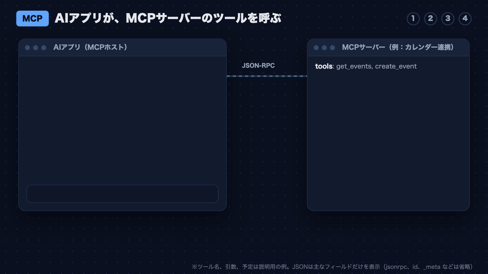
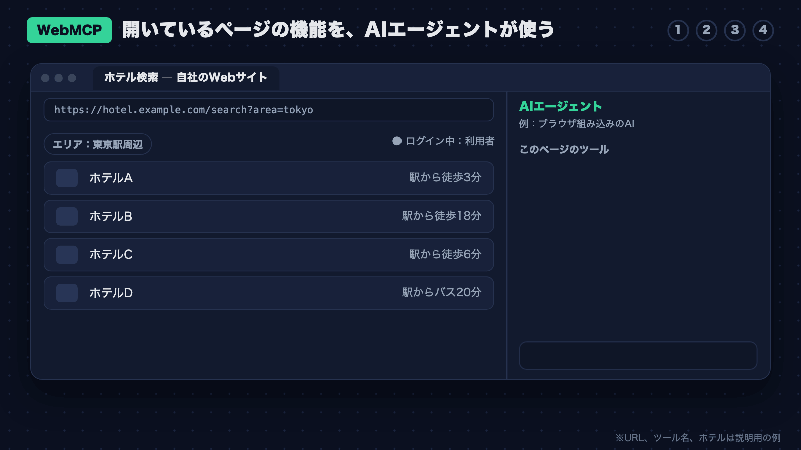
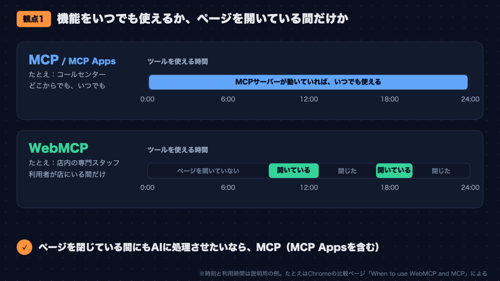
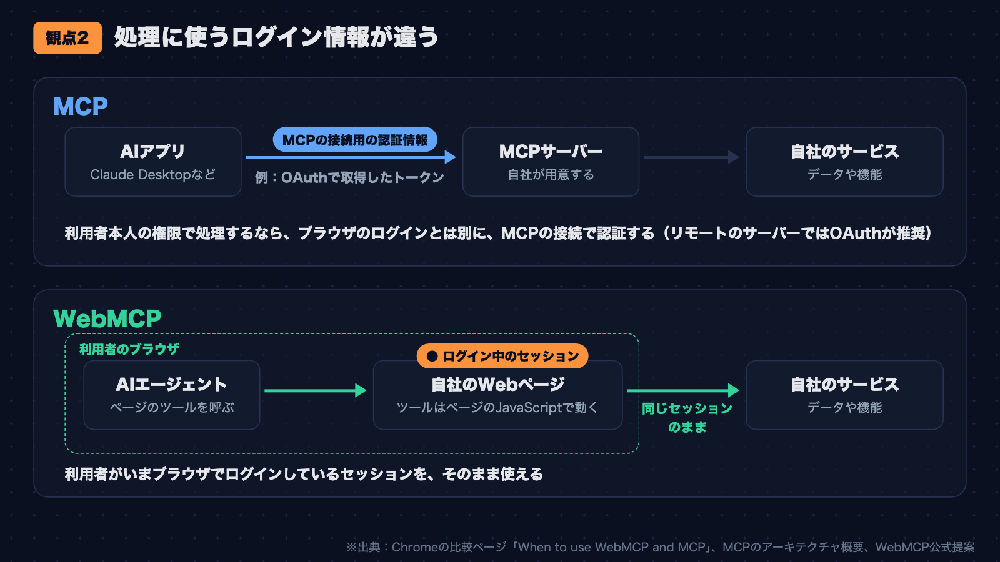
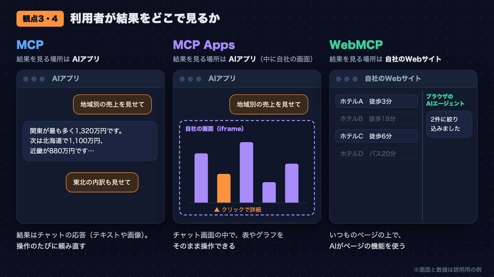

## はじめに

名前に「MCP」がつく技術に、MCP、MCP Apps、WebMCPの3つがあります。どれも、AIと外部のサービスやWebページを連携させるための技術です。名前が似ているこの3つは、どんな場面で使い分ければよいのでしょうか。

この記事では2026年11月5日時点の公式資料をもとに、どの場面でどれを選ぶかを整理します。

以降では、Claude DesktopやVS Codeのように、AIと会話しながら作業できるアプリを「AIアプリ」と呼びます。利用者の代わりに作業するAIを「AIエージェント」、AIが呼び出せる機能を「ツール」と呼びます。AIエージェントは、AIアプリの中で動くこともあれば、ブラウザや拡張機能の中で動くこともあります。

## 結論

3つの技術は、利用者が自社のWebサイトを開いているか、利用者が操作していない間もAIに処理させるか、結果をどのように見せるかで使い分けるのがよいと考えています。

| 選ぶ技術 | 向いている場面 |
|---|---|
| MCP | AIアプリから、自社のサービスの機能をツールとして使う。自社のWebサイトを開いていなくても使える。利用者が操作していない間の処理にも使える |
| MCP Apps | MCPの結果を、表や地図、フォームなどの操作できる画面にして、AIアプリのチャット画面に表示する |
| WebMCP | 利用者がブラウザで自社のWebサイトを開いている間に、AIエージェントが利用者の代わりにそのページの機能を使う |

3つは、必ずしもどれか1つだけを選ぶものではありません。Chromeの公式ドキュメント「[When to use WebMCP and MCP](https://developer.chrome.com/docs/ai/webmcp/compare-mcp)」は、MCPとWebMCPの両方を使う利点を説明しています。また、MCP AppsはMCPの拡張なので、使うにはMCPサーバーが必要です。

## 1. 3つの技術が提供するもの

最初に、3つの技術が何を提供するかを確認します。どこで処理を実行するかなどの違いは、この章の最後の比較表で比べます。

### MCP

MCP（Model Context Protocol）は、AIアプリを外部のシステムに接続するための標準の仕様です。

MCPの主な役割は、次の2つです。

- **MCPホスト**: AIアプリ本体です。Claude Code、Claude Desktop、VS Codeなどがこれにあたります。
- **MCPサーバー**: AIアプリに機能やデータを提供するプログラムです。

ホストの中には、サーバー1つとの接続を受け持つ「MCPクライアント」という部品もあります。この記事では、ホストとサーバーの関係だけを押さえれば十分です。

MCPサーバーが提供するものの中心は、AIが呼び出せる関数（ツール）です。AIアプリは、最初にツールの一覧（名前、説明、入力の形式）をMCPサーバーから取得します。AIアプリの中のAIエージェントが、その中から呼ぶツールを選びます。

MCPサーバーには、ローカルのMCPサーバーとリモートのMCPサーバーがあります。

次のアニメーションは、MCPでツールを呼ぶ流れを示したものです。利用者がAIアプリで頼むと、AIアプリはMCPサーバーのツールを呼び、返ってきた結果を会話に表示します。

[公式サイト](https://modelcontextprotocol.io/docs/getting-started/intro)が挙げる使い道は、次のようなものです。

- AIがGoogleカレンダーやNotionにアクセスし、個人に合わせたアシスタントとして動く
- 社内チャットボットが組織内の複数のデータベースに接続し、利用者がチャットでデータを分析する

### MCP Apps

MCP Appsは、MCPの公式拡張です。2026年1月26日に、最初の公式拡張として公開されました。MCPのツールは、一般的にはテキストや画像、データを返します。MCP Appsを使うと、ツールの結果をHTMLで作った画面で見せられます。ツールが呼ばれると、AIアプリはチャット画面の応答の位置に、その画面を埋め込んで表示します。

MCPサーバーは、ツールの定義に、結果を表示する画面のHTMLの場所を書いておきます。場所は、`ui://` で始まる文字列（URI）で表します。ツールが呼ばれると、次の4つの手順で画面が表示されます。

1. AIアプリが、MCPサーバーのツールを呼びます。
2. AIアプリは、ツールの定義に書かれた場所をもとに、画面のHTMLをMCPサーバーから取得します。ツールを呼ぶ前に取得しておくこともあります。
3. AIアプリは、取得したHTMLの画面をチャット画面に埋め込んで表示し、MCPサーバーから受け取ったツールの結果を画面に渡します。画面は、ページの中に別のページを埋め込む仕組み（iframe）で表示します。このiframeには、外側の画面や利用者のデータに触れられないよう制限をかけます（サンドボックス化）。この制限は仕様で必須です。
4. 利用者が画面を操作すると、画面からAIアプリを通して、MCPサーバーのツールを呼べます。ただし、MCPサーバーが画面から呼べないように設定したツールは呼べません。AIアプリが、呼び出しを止めたり利用者に確認したりすることもあります。

次のアニメーションは、この4つの手順を実際のメッセージ名とともに示したものです。画面のHTMLの場所（`_meta.ui.resourceUri`）は、AIアプリがツールの一覧を取得したときに受け取り済みとして扱っています。初期化のメッセージなど、一部は省いています（図の注記を参照）。図では、画面を簡略化して棒グラフで表しています。

MCP Appsを使うには、AIアプリ側の対応が必要です。[公式ドキュメント](https://modelcontextprotocol.io/extensions/apps/overview)では、Claude、Claude Desktop、VS CodeのGitHub Copilot、Microsoft 365 Copilot、Gooseなどが対応済みとして挙がっています。

### WebMCP

WebMCPは、Webページの機能を、ブラウザのAIエージェントなどがツールとして使えるようにするためのAPIです。たとえばホテルの検索ページなら、「条件で一覧を絞り込む」機能をツールとして登録しておくと、AIエージェントがそのツールを呼んで一覧を絞り込めます。開発者は `document.modelContext.registerTool()` を呼び、ツールの名前、説明文、実行する関数を登録します。

WebMCPは、まだ標準化の提案段階です。ChromeとEdgeでは、開発中の機能を本番のサイトで期間限定で試せる「Origin Trial」として提供されています。仕様と提供状況の詳細は、第5章で確認します。

WebMCPのツールは、利用者がそのページを開いている間だけ使えます。ページを閉じると、ツールも使えなくなります。

次のアニメーションは、このホテルの検索ページの例で、AIエージェントがページのツールを呼ぶ流れと、ページを閉じたあとの様子を示したものです。

WebMCPの仕組みと、ブラウザで動かす手順は、前回の記事で紹介しました。

https://qiita.com/tamakiiii/items/b0502acefe741305bfab

### 3つの技術の比較

3つの技術を、どこで処理を実行するか、どのAIがツールを呼ぶか、結果をどこに表示するかなどで比べると、次のようになります。

| | MCP | MCP Apps | WebMCP |
|---|---|---|---|
| 処理を実行する場所 | MCPサーバー | MCPサーバー（画面のHTMLはAIアプリの中で動く） | ブラウザで開いているページ |
| ツールを呼ぶAI | AIアプリ | AIアプリ | ブラウザのAIエージェントなど |
| 結果を表示する場所 | AIアプリのチャット | AIアプリのチャット | 自社のWebページ |
| 仕様の状態 | 公開済み | 公開済み | 提案段階 |

## 2. どれを使うかを判断する5つの観点

3つの技術のどれを使うかは、次の5つの観点で判断します。観点は、公式資料の記述をもとに筆者が整理したものです。

### 観点1: 機能をいつでも使えるようにするか

1つ目の観点は、機能をいつでも使えるようにするか、利用者がページを開いている間だけでよいかです。[Chrome公式](https://developer.chrome.com/docs/ai/webmcp/compare-mcp)は、MCPを「コールセンター」、WebMCPを「店内の専門スタッフ」にたとえています。コールセンターにはいつでもどこからでも電話できますが、店内のスタッフは客が店にいる間しか対応しません。

WebMCPのツールは、利用者がページから移動したりタブを閉じたりすると、使えなくなります。ページを開いていない時間にもAIに処理させたい機能には、3つの中ではMCPとMCP Appsが向いています。

### 観点2: どのログイン情報で処理するか

2つ目の観点は、処理に使うログイン情報です。[Chrome公式](https://developer.chrome.com/docs/ai/webmcp/compare-mcp)によると、MCPは接続のために用意した認証情報を使い、WebMCPは利用者がいまブラウザでログインしている状態（セッション）をそのまま使います。

MCPでも、利用者本人の権限で処理することはできます。その場合は、ブラウザのログインとは別に、MCPサーバーへの接続で認証が必要です。リモートのMCPサーバーについては、MCPの[公式ドキュメント](https://modelcontextprotocol.io/docs/learn/architecture)が、認証用のトークンをOAuth（利用者の許可を得て、アクセス用のトークンを発行する仕組み）で取得する方法を推奨しています。

利用者がブラウザでログインしている権限のまま処理させたいなら、接続の認証を別に用意しなくてよいWebMCPのほうが手軽です。

### 観点3: 利用者が結果をどこで見るか

3つ目の観点は、利用者が結果を、AIアプリと自社のWebサイトのどちらで見るかです。既存のサイトの画面の上でAIに作業させるならWebMCP、AIアプリのチャット画面に自社の画面を出すならMCP Appsです。

[Chrome公式](https://developer.chrome.com/docs/ai/webmcp/compare-mcp)は、MCP AppsとWebMCPの違いを、画面をどこに表示するかで説明しています。MCP Appsの画面はAIアプリ側の制約に合わせる必要があり、既存のWebサイトとは別のアプリケーションとして作ります。WebMCPでは、利用者が開いている既存のWebサイトの上でAIが作業するので、別の画面を作る必要はありません。

### 観点4: テキストの応答で要件を満たせるか

4つ目の観点は、AIアプリの中で結果を見せるときに、テキストの応答で要件を満たせるかです。これは、MCPのツールだけで済ませるか、MCP Appsを追加するかの判断に関わります。

MCP Appsの公式ドキュメントは、MCP Appsが向いている場面として次の5つを挙げています。

| 場面 | 公式ドキュメントの例 |
|---|---|
| 複雑なデータを調べる | 地域別の売上を地図で表示し、地域をクリックして詳細を見る |
| 選択肢の多い設定を行う | 多くの選択肢を、会話で1つずつ答える代わりに、1つのフォームでまとめて選ぶ |
| 画像や文書などを見る | PDFや3Dモデルを、拡大や回転ができるビューアで表示する |
| 状態をリアルタイムで見守る | メトリクスやログ、システムの状態が変わるたびに、表示を更新する |
| 複数の手順を進める | 経費の承認、コードレビュー、課題の振り分けで、項目を1つずつ確認して操作する |

観点3の図の左側のように、テキストだけで同じことをすると、利用者は「東北の内訳も見せて」「売上順に並べて」のように、操作のたびにAIへ頼み直すことになります。MCP Appsの[公式ブログ](https://blog.modelcontextprotocol.io/posts/2026-01-26-mcp-apps/)は、この手間をMCP Appsで解消すると説明しています。

一方で、公式ドキュメントは、通常のWebアプリを作る選択肢とも比べています。MCP Appsの利点は、会話の流れの中で画面を使えることや、画面からMCPサーバーのツールを呼べることです。こうした利点が必要ない場合は、通常のWebアプリのほうが簡単かもしれない、とも書いています。

### 観点5: 利用者が画面を見ながらAIと作業するか

5つ目の観点は、利用者が画面を見ながら、AIと一緒に作業するかです。

WebMCPの[公式提案](https://github.com/webmachinelearning/webmcp)は、利用者がページを見ながら、AIと一緒に作業する使い方を想定しています。ブラウザの画面を開かずに、AIだけで自律して動く使い方は対象外です。[Chrome公式](https://developer.chrome.com/docs/ai/webmcp)も、主な用途は、利用者が画面を見ながら行うブラウザでの作業だとしています。

一方、MCPについては、[Chrome公式](https://developer.chrome.com/docs/ai/webmcp/compare-mcp)がバックグラウンドの作業をMCPサーバーの役割として挙げています。筆者は、これらの記述から、利用者が操作していない間にAIだけで動かす処理はMCPで提供するほうが合っていると考えています。

## 3. ユースケースごとに向いている技術

公式資料に載っているユースケースと、それに向いている技術をまとめました。技術名のリンク先が、そのユースケースを載せている公式資料です。「理由」と「判断の観点」は筆者が付けたもので、観点は第2章の5つの観点を指します。

| ユースケース | 向いている技術 | 理由 | 判断の観点 |
|---|---|---|---|
| AIがGoogleカレンダーやNotionにアクセスする | [MCP](https://modelcontextprotocol.io/docs/getting-started/intro) | ページを開かずに、AIアプリからいつでも使う | 観点1：いつでも使えるか |
| 社内の複数のデータベースをチャットで分析する | [MCP](https://modelcontextprotocol.io/docs/getting-started/intro) | ページを開かずに、AIアプリの会話から複数のデータベースをいつでも使う | 観点1：いつでも使えるか |
| 地域別の売上を地図で調べる | [MCP Apps](https://modelcontextprotocol.io/extensions/apps/overview) | テキストでは操作のたびに頼み直す必要がある | 観点4：テキストで要件を満たせるか |
| 選択肢の多い設定をフォームで行う | [MCP Apps](https://modelcontextprotocol.io/extensions/apps/overview) | 選択肢が多く、会話の往復では手間がかかる | 観点4：テキストで要件を満たせるか |
| サーバーの状態を監視する | [MCP Apps](https://modelcontextprotocol.io/extensions/apps/overview) | 表示を継続して更新する必要がある | 観点4：テキストで要件を満たせるか |
| 店ごとの価格を比べてウィッシュリストを作る | [WebMCP](https://developer.chrome.com/docs/ai/webmcp/use-cases) | カートに入れる前に、利用者がウィッシュリストの商品を画面で確認できる | 観点5：画面を見ながら作業するか |
| フォームに入力する（作業時間の記録、保証の申請など） | [WebMCP](https://developer.chrome.com/docs/ai/webmcp/use-cases) | 既存のページのフォームを使う。保証の申請のように、足りない情報を利用者に入力してもらう流れも作れる | 観点3：結果をどこで見るか |
| 賃貸物件やホテルの検索結果を条件で絞り込む | [WebMCP](https://developer.chrome.com/docs/ai/webmcp/use-cases) | 既存のサイトの絞り込み機能を使う | 観点3：結果をどこで見るか |
| Gerritでコードレビューを補助する | [WebMCP](https://github.com/webmachinelearning/webmcp) | 画面が複雑なツールで、ページの機能をAIに直接使わせる。AIの修正案は、利用者がレビュー画面で採否を決める | 観点3：結果をどこで見るか 観点5：画面を見ながら作業するか |

## 4. どれを使うかを考えるための3つの問い

第2章の5つの観点を、技術ごとに「使う候補になるか」を確かめる3つの問いにまとめました。答えが「はい」になった技術が、使う候補です。

| 問い | 「はい」なら候補 | 補足 |
|---|---|---|
| 1. 利用者が自社のWebサイトを開いている間に、AIにページの機能を使わせたいか | WebMCP | 利用者のログイン状態をそのまま使える。仕様は提案段階（第5章） |
| 2. AIアプリから、ページを開かずに自社の機能を使わせたいか | MCP | 利用者が操作していない間の処理（定期的な処理など）も含む |
| 3. 結果を、チャット画面の中で操作できる形で見せる必要があるか | MCP Apps | MCPの拡張なので、問い2が「はい」のときだけ答える |

### 問い1と問い2が両方「はい」の場合

MCPとWebMCPの両方が候補です。[Chrome公式](https://developer.chrome.com/docs/ai/webmcp/compare-mcp)は、2つの役割分担を次のように説明しています。MCPサーバーが基本の処理やデータの取得、バックグラウンドの作業を受け持ちます。WebMCPは、利用者がサイトを開いている間の操作を受け持ちます。同じページは、MCPとWebMCPを「partners, not opponents（対立相手ではなく協力相手）」と表現しています。

## 5. 採用する前に確認すること

技術ごとに、対応状況と設計上の注意点を確認します。

**MCP**

- 対応している仕様のバージョンは、AIアプリごとに違います。
- リモートのMCPサーバーとして提供する場合は、利用者のAIアプリがリモートのMCPサーバーへの接続に対応しているかを確認します。
- [MCPの仕様](https://modelcontextprotocol.io/specification/2026-07-28)は、ツールを呼ぶ前に利用者の明示的な同意を得ることを原則としています。同意の得方はAIアプリの実装に任されているので、筆者は、利用者が操作していない間の処理でも、取り消しにくい操作は実行前に止めて利用者の承認を待つ流れを勧めます。

**MCP Apps**

- 画面が表示されるのは、MCP Appsに対応したAIアプリだけです。対応状況は[クライアント対応表](https://modelcontextprotocol.io/extensions/client-matrix)で確認します。
- 非対応のAIアプリでは、通常のMCPのツールとして扱われます。そのため[MCP Appsの仕様](https://github.com/modelcontextprotocol/ext-apps/blob/main/specification/2026-01-26/apps.mdx)は、画面つきのツールでもテキストなどの結果（`content`）を返すことを必須とし、テキストだけで使える振る舞いを用意することを推奨しています。

**WebMCP**

- 仕様はW3Cのコミュニティグループが公開している[草案](https://webmachinelearning.github.io/webmcp/)（2026年11月2日版）で、今後変わる可能性があります。
- WebMCPを実装したブラウザと、ツールを呼べるAIエージェントは、公式提案の[実装状況のページ](https://github.com/webmachinelearning/webmcp/blob/main/implementation-status.md)で確認します。
- 本番のサイトで試すには、Origin Trial（Chromeは149から、Edgeは150から）に登録します。期限があるので、各トライアルのページで確認します。
- 手元で試すだけなら、Chromeの `chrome://flags/#enable-webmcp-testing` を有効にして再起動します。手順は[前回の記事](https://qiita.com/tamakiiii/items/b0502acefe741305bfab)で紹介しています。
- AIは、サイトを開くまで、そのサイトにツールがあるかを知れません（[Chrome公式](https://developer.chrome.com/docs/ai/webmcp)）。利用者にページを開いてもらう前提で設計します。

## まとめ

3つの技術は、利用者が自社のWebサイトを開いているか、利用者が操作していない間もAIに処理させるか、結果をどのように見せるかで使い分けるのがよいと考えています。

- ページを開いていないときや、利用者が操作していない間にも使わせたい機能は、MCPで提供するのが向いています（利用者の操作なしで動かせるかは、呼び出すAIアプリの設定による）。
- MCPの結果をチャット画面の中で操作させたい場合は、MCP Appsの追加を検討するとよいでしょう。
- 利用者が自社のWebサイトを開いている間の作業は、WebMCPでAIに任せるのが向いています。

自社のサービスで検討するときは、まず、利用者がAIに頼む場面を書き出します。そのうえで、各場面で、利用者が自社のWebサイトを開いているかと、利用者が操作していない間もAIに処理させるかを確認すると、使う技術を考えやすくなります。

## 参考文献

- [What is the Model Context Protocol (MCP)?](https://modelcontextprotocol.io/docs/getting-started/intro)
- [MCPのアーキテクチャ概要](https://modelcontextprotocol.io/docs/learn/architecture)
- [MCP仕様（2026-07-28版）](https://modelcontextprotocol.io/specification/2026-07-28)
- [MCP仕様（2026-07-28版）のツール](https://modelcontextprotocol.io/specification/2026-07-28/server/tools)
- [MCP Apps（公式ドキュメント）](https://modelcontextprotocol.io/extensions/apps/overview)
- [MCP Apps - Bringing UI Capabilities To MCP Clients（MCP公式ブログ、2026年1月26日）](https://blog.modelcontextprotocol.io/posts/2026-01-26-mcp-apps/)
- [MCP Apps仕様（2026-01-26版）](https://github.com/modelcontextprotocol/ext-apps/blob/main/specification/2026-01-26/apps.mdx)
- [SEP-1865: MCP Apps](https://modelcontextprotocol.io/seps/1865-mcp-apps-interactive-user-interfaces-for-mcp)
- [When to use WebMCP and MCP（Chrome for Developers）](https://developer.chrome.com/docs/ai/webmcp/compare-mcp)
- [WebMCP（Chrome for Developers）](https://developer.chrome.com/docs/ai/webmcp)
- [How WebMCP fits in user journeys（Chrome for Developers）](https://developer.chrome.com/docs/ai/webmcp/use-cases)
- [WebMCP公式提案（GitHub）](https://github.com/webmachinelearning/webmcp)
- [WebMCP仕様草案](https://webmachinelearning.github.io/webmcp/)
- [WebMCPの実装状況](https://github.com/webmachinelearning/webmcp/blob/main/implementation-status.md)
